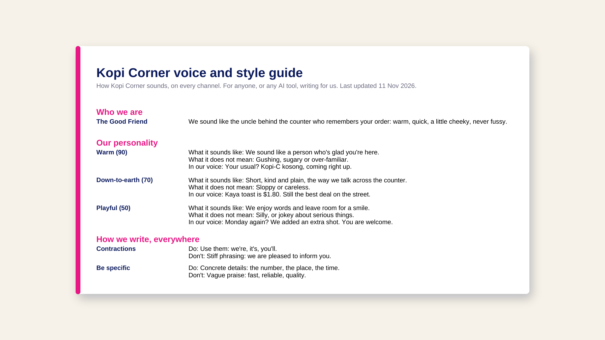

# Toolkit 02: Brand voice

Write down how your brand sounds, so every writer and every AI tool sounds like you. About an hour.

Version 2.2 · 12 Nov 2026 · Mavic steps checked 11 Nov 2026

| File | What it is |
| --- | --- |
| `README.md` | The method (this page) |
| `worksheet.md` | The fill-in worksheet: copy it and answer each part |
| `presets.md`, `presets.json` | Starting points: 12 archetypes, 24 traits, 13 channels, 21 do and don't rules, 9 ban list packs, 10 test prompts |
| `sources.md` | Every claim and where it comes from |
| `images/blog-style-guide-example.png` | A finished guide for the demo brand, Kopi Corner |

Where the answers go: `workbenches/brand-dna/brand-book.md`. A filled-in example: `workbenches/examples/kopi-corner/`.
The skill that checks drafts against it: `skills/brand-voice-check/`.
Prefer a spreadsheet? The designed workbook (Excel and Google Sheets), which writes your style guide for you, is a free download at [mavic.ai/toolkits](https://mavic.ai/toolkits/brand-voice-tone-guide-template/?utm_source=github&utm_medium=readme&utm_campaign=brand_voice_workbook).

## Why AI sounds generic

AI works with two kinds of data. The first is what it learned in training: sealed inside the model, and the same for everyone. The second is what you give it: your prompt, your files, your brand information. Training gives it a general sense of how brands sound. Only what you give it can tell it how your brand sounds.

Give it too little, and it fills the gaps with the average of everything it has seen. Give it too much, and the rules that matter get buried: language models use information at the start and end of a long input better than information in the middle (Liu et al., 2024; see `sources.md`).

So the goal isn't a longer brand book. It's the few inputs that shape the output, written specifically enough to follow.

## Which input shapes which output

| Input | What it shapes |
| --- | --- |
| Personality | Attitude and word choice |
| Writing style, one per channel | How sentences are built: length, openings, closings, formatting |
| Ban list | What it never says |
| Visual identity | Logo, colours, fonts and layout in every image |
| Customer profiles | Who it's talking to |
| Products and services | Getting the facts right |

This toolkit covers the first three, the ones that decide how your words sound.

## The method: five steps

Examples are for Kopi Corner, a fictional Singapore coffee shop.

1. **Personality (15 min).** Pick an archetype, then 3 to 5 traits that are true today, not ones you hope for. Weight each from 0 to 100, highest for the trait that defines you most. For each, write what it sounds like, what it does not mean, and one line in your voice. If a competitor would claim the same trait, sharpen it.
   > Warm (90). We sound like a person who's glad you're here. Not: gushing, sugary or over-familiar. "Your usual? Kopi-C kosong, coming right up."
2. **Tone by channel (15 min).** Your personality stays the same; your tone changes with the room. For each channel you use, write who it's for, how formal you are (1 to 5), sentence length, how you open, how you close, how you format, how you use examples and data, when you mention the product, and one example line. Start with who it's for: it changes the tone more than anything else.
3. **Do and don't (10 min).** Turn your taste into rules a stranger could follow without asking you, each with an example of both sides. Five to eight rules is plenty.
   > Be specific. Do: "Kaya toast is $1.80." Don't: "Great value breakfast."
4. **Ban list (10 min).** List 20 to 30 words and phrases you never want to see: the AI cliches (the presets start you with 15), the words everyone in your category uses, and your competitors' favourite phrases. Ban phrases as well as single words, and say what to use instead.
5. **Test (10 min).** Write or generate five posts from the test prompts. Read each one out loud. Does it sound like you? Is it free of banned words? When something's off, don't just fix the post: fix the rule behind it, then run the same request again and compare.

3 to 5 traits, 5 to 8 rules, 20 to 30 ban list entries and five test posts are rules of thumb, not research. Change them if your tests say so.

## Use it with any AI tool

Paste your finished `brand-book.md` into your tool's instructions (a Claude project, a custom GPT, a Gemini Gem), or install `skills/brand-voice-check` and ask it to check a draft. Keep the guide short: the inputs that shape the output, nothing more.

## Do it in Mavic

In [Mavic](https://mavic.ai/?utm_source=github&utm_medium=readme&utm_campaign=brand_voice_workbook), all of this lives in your Brand DNA, and Mavic works from it on every post, image and video. The workbench mirrors its fields, so moving in is copy and paste.

- **Personality:** Brand DNA > Branding > Personality. Add your archetype and traits, each with its weight. Help: [Brand Personality](https://mavic.crisp.help/en/article/brand-personality-1vjdb23/)
- **Writing style:** Brand DNA > Branding > Writing style. One per channel, with a title, a one-sentence description and that channel's style guide. Help: [Writing Style](https://mavic.crisp.help/en/article/writing-style-fzezr4/)
- **Ban list:** Brand DNA > Branding > Ban list. Mavic suggests a ban list for your brand to start from; add your own with + Add term, or paste your list as one comma-separated line. Help: [Ban List](https://mavic.crisp.help/en/article/ban-list-1lx69y5/)
- **Test:** in a new chat, type @ to pick your Writing style and a Customer profile, then ask for a post. Fix the rule in Brand DNA, save, and run the same request again.

The ban list is a strong nudge, not a hard filter, so read long drafts before you schedule them.

## Videos

- Explainer: What is a brand? (Mavic YouTube, link on release)
- How-to: How to make AI sound like your brand (Mavic YouTube, link on release). Script pack: `video/examples/mavic/ep1b/`.
